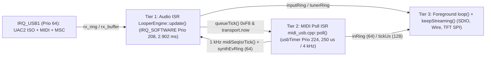

# Capstan Architecture (`v1.5`)

> **Hardware Reference**: For pinouts, peripheral buses, display drivers, codec/charger setup, and composite USB details, see [M8 Hardware Reference](./HARDWARE.md).

## 1. Overview

**Capstan** (`CAPSTAN_VERSION = "1.5"`) is a custom firmware for the **M8 Model:01** (Teensy 4.0) and **M8 Model:02** (Teensy MicroMod) implementing:
- **8-Track Linear Audio Tape Recorder**: 4 Stereo tracks (`A1`–`A4`, 16-bit 44.1 kHz stereo PCM) + 4 Mono tracks (`A5`–`A8`, 16-bit 44.1 kHz mono PCM, `L`/`R`/`LR` input tap), up to **666 seconds** (`29,370,600` frames) per track, with variable-speed playback (`-5.00x` to `+5.00x`, granular scrub above `2.00x`), sound-on-sound overdub, replace recording, `20` `AudioRecSrc` capture taps (`LIN`, `USB`, `M01`–`M08`, `A01`–`A08`, `PRE`, `PST`, plus `SRC` off; `Count = 21`), and `8 fps` 4-bit nibble waveform overviews.
- **8-Track Linear MIDI Sequencer & Piano Roll Editor**: `480 PPQN` resolution, up to `2,048` events per track (`128 KB` total in `RAM2 DMAMEM`), recording Note On/Off, Control Change (CC), and Pitch Bend, with per-track input (`OFF`, `ALL`, `01`–`16`), output routing (`OFF`, external `C01`–`C16`, or internal instruments `I01`–`I08`), quantization (`4th`/`8th`/`16th`/`32nd`), an interactive 18-row Piano Roll overlay, and Format 0 `.mid` import/export.
- **8-Slot Multi-Engine Internal Synthesizer, Sampler & SoundFont Host (`I01`–`I08`)**: `32`-voice dynamically shared global polyphony pool (up to `8` voices per instrument), per-voice 2-pole SVF + quadratic ADSR envelopes, `instBusLimiter`, isolated `captureMidiTrack` stem rendering, and **five modular `InstEngineOps` engines**:
  1. **2-Operator FM (`FM2`)**: 3 algorithms (`[A][B]`, `[B]>[A]`, `[A]>[B]`), `0.00`–`24.00` continuous frequency ratios, self-feedback, and per-operator ADSR.
  2. **Phase Distortion (`PD`)**: 8 classic waveforms with dual-line modulation (`Phase`, `Ring`, `Sync`, `Noise`) and 5.5 kHz DCW phase-shaping precomputation.
  3. **SD Card WAV Sampler (`SMP`)**: 4-octave (`C3`–`B6`, 48-key) keyboard with per-key SD WAV assignment, live audio-input sample recording, 4 trigger modes (`STOP`, `ONCE`, `REP`, `REPTHRU`), and 8 concurrent `RAM1`-staged SD streaming slots.
  4. **Noise Texture Drone (`NTD`)**: 3-layer drone synthesizer (`DRONE OSC` + `NOISE BED` + `CRACKLE & MOD`) with `Gate`, `Latch`, and `Auto` sustain modes and `RAM2` voice state.
  5. **SoundFont 2.x (`SF2`)**: RIFF `sfbk`/`pdta` Hydra parser (`/Capstan/SOUNDFONTS/*.sf2`, `254`-zone `RAM2` pool, `41.1 KB` `RAM1` `sf2PreRoll` attack/micro-loop cache, ring-locked sustain loops via shared `samplerStreams`, Catmull-Rom Hermite HQ vs. Linear interpolation, anti-aliased SVF, and `pmod`/`imod` MIDI modulators).
- **4-Context Modular Effects & Option A Gain Staging**:
  - Shared `Chorus -> Delay -> Reverb` tank (`MASTER > TRACK > INST > IN`) plus isolated `Drive`, `17-tap FIR + Wow/Flutter Tape`, and `Opto Glue Comp` across **Master FX** (5 slots + `D.FB`), **Per-Audio-Track FX** (`A1`–`A8`, 6 slots insert + aux), **Instrument FX** (`I01`–`I08`, 7 slots + `OUT LEVEL`), and **Audio Input FX** (7 slots + `OUT VOL` pre-monitor & pre-record).
  - Three 32-sample `LookaheadMonitorLimiter` guards (`instBusLimiter`, `postFxLimiter`, `monLimiter`), hybrid Line-In gain (`-12.0..+12.0 dB` via 1.5 dB SGTL5000 analog steps + digital trim), and **Option A hybrid Headphone (`-51.5..+6.0 dB` analog `0.5 dB` slewed PGA + up to `+8.0 dB` digital) & Speaker (`40` default)** dual volume curves.
- **Chromatic Tuner, Projects & Comprehensive MIDI/USB Integration**:
  - **Chromatic Tuner**: `2x`-decimated `4 KB` `RAM1` `tunerRing`, `20 Hz` two-band YIN CMNDF detector with parabolic fit, `30 Hz` strobe UI, per-song `A4 REF` (`400.0..480.0 Hz`), `SHIFT+EDIT` pitch match, and live pre-Drive MIDI audition.
  - **Projects & Exports**: `/Capstan/PROJECTS/*.proj` setlist player with power-button Play Lock (`LOCK ->`), 1.0x realtime Master WAV bounce (`<Song>/<Song>.wav`), and non-realtime SMF0 MIDI track/clip export (no per-track WAV stem export exists).
  - **MIDI & USB**: External MIDI Clock sync (`Internal`, `Ext Auto`, `Ext USB`, `Ext TRS`), Clock Out with echo suppression, Standard MIDI Transport (`0xFA`/`0xFB`/`0xFC`/`0xF2`) & MMC SysEx, `5`-category (`157`-target) Global MIDI CC Map (`SYSTEM.DAT` **v5**), `34`-slot Per-Instrument CC Map (`IMAP`/`IM1P`), Variant B `USB CHARGE WHILE ON` descriptor re-enumeration, and composite `Serial + MIDI + 2-ch In/Out UAC2 Audio + dynamic MSC` USB (`usb=serialmsc`).

---

## 2. Source Module Map

| File | Responsibility |
|---|---|
| [`Capstan.ino`](../Capstan.ino) | `setup()` / `loop()`, Teensy Audio graph (`AudioInputI2S -> LooperEngine -> AudioOutputI2S`), `CAPSTAN_DEBUG` freeze watchdog (`prio 255`), power button, SD hot-swap |
| [`build_all.py`](../build_all.py) | Unified build, verification, and release packaging script for Model:01 (`teensy40`) and Model:02 (`teensyMM`) |
| [`src/config.h`](../src/config.h) | Global constants (`CAPSTAN_VERSION = "1.5"`, `SAMPLE_RATE_HZ = 44100`, `MAX_TAPE_SECONDS = 666`, buffer sizes, Option A HP/Spk gain laws, `MIDI_PPQN = 480`, `SCREEN_BLANK_TIMEOUT_MS`) |
| [`src/colors.h`](../src/colors.h) | Compile-time `rgb565()` / `blend565()` palette and per-page / per-track / tick colors |
| [`src/M8Board.h`](../src/M8Board.h), [`src/M8Board.cpp`](../src/M8Board.cpp), [`src/ili9341_spi.h`](../src/ili9341_spi.h), [`src/ili9341_spi.cpp`](../src/ili9341_spi.cpp), [`src/ili9488_spi.h`](../src/ili9488_spi.h), [`src/ili9488_spi.cpp`](../src/ili9488_spi.cpp) | Hardware abstraction for M8 Model:01 (Variants A & B, `ILI9341Spi` @ `30 MHz`) and Model:02 (`ILI9488Spi` @ `60 MHz` RGB666): I2C keys (`MCP23008`/`SX1508`), headphone sense, speaker amp, `BQ2589x` + `STC3115` + `chargeGuard()`, Pin 1 SD rail, Model:02 D-latch `powerOff()`, TRS MIDI |
| [`src/engine.h`](../src/engine.h), [`src/engine.cpp`](../src/engine.cpp) | 44.1 kHz Audio ISR (`LooperEngine::update()`): 8-track playback, overdub/replace/resample capture, varispeed (`-5.00x..+5.00x`), punch/loop window, threshold trigger, adaptive LUT woodblock metronome, per-track Vol/Bal/Pan/Solo, 2-ch stereo USB UAC2 I/O |
| [`src/master_fx.h`](../src/master_fx.h), [`src/master_fx.cpp`](../src/master_fx.cpp) | Modular `MasterFxOps` & shared Q14 DSP engine (`Drive`, `Chorus`, `Delay`, `Reverb`, `Tape`, `Comp`) across Master, Audio Track, Instrument, and Audio Input contexts + `LookaheadMonitorLimiter` |
| [`src/midi_seq.h`](../src/midi_seq.h), [`src/midi_seq.cpp`](../src/midi_seq.cpp) | 8-track linear MIDI sequencer (`480 PPQN`, `2,048` events/track in `DMAMEM`), 1 kHz playback & 4 kHz Live Thru, Piano Roll note helpers, `MIDI.DAT` v2, `.mid` SMF0 import/export |
| [`src/midi_in.h`](../src/midi_in.h), [`src/midi_in.cpp`](../src/midi_in.cpp) | External MIDI Clock slave (`0xF8`, `0xFA`, `0xFB`, `0xFC`, `0xF2`) w/ multi-beat hysteresis, MMC SysEx parser, TRS Serial MIDI parser |
| [`src/midi_usb.h`](../src/midi_usb.h), [`src/midi_usb.cpp`](../src/midi_usb.cpp) | Unified 250 µs (`4 kHz`, prio `224`) `IntervalTimer` polling TRS + USB MIDI, running `midiSeqIsrTick()` at `1 kHz`, and transmitting via DTCM `usbMidiTxBuf` |
| [`src/midi_map.h`](../src/midi_map.h), [`src/midi_map.cpp`](../src/midi_map.cpp) | Global MIDI CC Map (`5` categories, `157` targets, `mappedCcChMask[128]`), virtual MIDI navigation/modifiers, Per-Instrument CC Map (`34` slots, `IMAP`/`IM1P`) & MIDI Learn |
| [`src/instruments.h`](../src/instruments.h), [`src/instruments.cpp`](../src/instruments.cpp), [`src/inst_fm2op.*`](../src/inst_fm2op.h), [`src/inst_phasedist.*`](../src/inst_phasedist.h), [`src/inst_sampler.*`](../src/inst_sampler.h), [`src/inst_noisedrone.*`](../src/inst_noisedrone.h), [`src/inst_sf2.*`](../src/inst_sf2.h) | 8-slot `InstEngineOps` host (`32` voices, `instBusLimiter`, `captureMidiTrack` stems, `INST.DAT` v3 / `.FMI` v3) + 5 synthesis/sample engines (`FM2`, `PD`, `SMP`, `NTD`, `SF2`) |
| [`src/tuner.h`](../src/tuner.h), [`src/tuner.cpp`](../src/tuner.cpp) | Chromatic Tuner (`2x`-decimated `tunerRing` ISR tap, `20 Hz` two-band YIN CMNDF + parabolic fit, `A4 REF` pitch match) |
| [`src/storage.h`](../src/storage.h), [`src/storage.cpp`](../src/storage.cpp), [`src/paged_dir_scanner.h`](../src/paged_dir_scanner.h) | `DMA_SDIO` streaming (`AUDIO/TRACK1.WAV`–`TRACK8.WAV`), shared `16 KB` `RAM1` `chunk`, shared paged SD browser helpers, manual-save-only song/project/system persistence (`SONG.DAT` v3 w/ legacy v2 read compatibility, `MIDI.DAT` v2, `INST.DAT` v3, `SYSTEM.DAT` v5, `*.proj`), realtime Master WAV bounce |
| [`src/track_edit.h`](../src/track_edit.h), [`src/track_edit.cpp`](../src/track_edit.cpp) | Modular `TRACK_EDIT_OPS` (`SET PUNCH/LOOP REGION`, `QUANTIZE`, `COPY`, `CUT`, `PASTE`, `DUPL`, `CLR`, `EXPORT/LOAD CLIP`) for Audio and MIDI tracks |
| [`src/app.h`](../src/app.h), [`src/app.cpp`](../src/app.cpp) | Shared UI/cursor/modal state, `setPage()` lifecycle, `SGTL5000` PGA slewing, USB charge descriptor sync, transport & step helpers |
| [`src/pages.h`](../src/pages.h), `src/page_*.h`, `src/page_*.cpp` | `PageOps` descriptors for all 9 pages (`Audio`, `Midi`, `SongSettings`, `Main`, `SystemSettings`, `Instruments`, `InstrumentType`, `InstrumentEdit`, `Master`) |
| [`src/input.h`](../src/input.h), [`src/input.cpp`](../src/input.cpp) | Key scanner (`pollKeys`), 15-level modal priority stack, directional repeat, `OPT` scrub & chords, virtual MIDI nav parity |
| [`src/ui.h`](../src/ui.h), [`src/ui.cpp`](../src/ui.cpp), [`src/ui_font.*`](../src/ui_font.h), [`src/ui_splash.cpp`](../src/ui_splash.cpp) | `Surface` offscreen compositor (`cellBuf`), `SX`/`SY`/`TY` scaling, `85`-glyph `GLYPH_LUT`, `hashMix` dirty cache, multi-tier UI scheduler, 5-min blanking, OKLCH SDF cassette splash |
| [`src/usb_drive.h`](../src/usb_drive.h), [`src/usb_drive.cpp`](../src/usb_drive.cpp), [`src/usb_names.c`](../src/usb_names.c) | USB Mass Storage Drive mode (`0x048A <-> 0x04D5` sharing `looper::chunk`) and `HW_OCOTP_MAC0` serial (`CAPSTAN-01/02-<8HEX>`) |
| [`tools/teensy_msc/patch.py`](../tools/teensy_msc/patch.py) | Teensyduino 1.62.0 core patch enabling composite `Serial + MIDI + Audio (2-ch In/Out UAC2) + dynamic MSC` (`usb=serialmsc`) |
| [`tools/recorder_sim/verify_firmware.py`](../tools/recorder_sim/verify_firmware.py) | 4-suite automated verifier (Source Invariants, Binary/WAV/SF2 Format, Model:01 & Model:02 ELF Memory Regions, Public Release Cleanliness) |

---

## 3. Three-Tier Real-Time Threading Architecture

1. **Hardware IRQs (`IRQ_USB1` prio `64`, `SDIO` `96`, `DMA` `128`, `Wire` `144`)**: Preempt Audio/MIDI/Loop as required; `usb_audio_l7` keeps rolling UAC2 DMA packet descriptors in uncached `DTCM` and computes `ARM_DWT_CYCCNT` vs. `USB1_FRINDEX` SOF host rate estimation.
2. **Tier 1 — Audio ISR (`LooperEngine::update()`, `IRQ_SOFTWARE` priority `208`, every `128` samples = `2.902 ms`)**:
   - Advances `transport.now` and `transport.tapeFrame`, evaluates count-in beats, `WaitThreshold` triggers, and punch/loop window transitions (`Armed -> Active -> Finishing`), and queues `0xF8` clock timestamps (`queueTick()`). *Note: `LooperEngine::update()` does **not** call `midiSeqIsrTick()`.*
   - Pushes `2x`-decimated Chromatic Tuner taps (`pushTunerInputBlock`), calls `fmSynthRenderBlock()` (draining `synthEvRing` with `0..127` sub-block splits across all 5 engines + `instBusLimiter` + `captureMidiTrack` stems), runs Audio Input FX (`processAudioInputFxBlock`), reads the 8 track `rings`, applies per-track Insert FX + smoothed `curMix` + shared Aux return + Master FX (`processMasterFx`), writes `inputRing[INPUT_FRAMES]`, streams UAC2 Out, and applies `postFxLimiter` / `monLimiter`.
3. **Tier 2 — Unified MIDI Poll ISR (`midi_usb.cpp::poll()`, `IntervalTimer` `usbTimer` at `250 µs` / `4 kHz`, priority `224`)**:
   - Runs **strictly below** Audio ISR (`224 > 208`) so MIDI polling never preempts an audio block, while preempting `loop()` (`SdFat`, `Wire`, `SPI`) and `freezeTimer` (`255`).
   - Polls TRS Serial MIDI (`midiServiceTrsInOut()`) and up to `USB_MIDI_RX_BUDGET_PER_TICK = 64` USB MIDI packets (`usbMIDI.read()`).
   - Executes `midiSeqIsrTick()` -> `midiSeqDispatchPlayback()` on **every 4th tick (`1 kHz` / `1.0 ms`)**.
   - Performs immediate ISR Live MIDI Thru and internal synth voice triggering (`allowSdIo = false`; misses defer to `loop()` `drainMidiInputRing()`), and submits queued USB `0xF8` ticks and `MidiPacket`s via `usb_transmit()` under `NVIC_DISABLE_IRQ(IRQ_USB1)`.
4. **Tier 3 — Main Loop (`loop()` + `keepStreaming()`)**:
   - Runs `board.chargeGuard()`, `handlePowerButton()`, 500 ms stopped SD hot-swap check, `serviceStorage()` (`fillTrackRing`, `samplerServiceActiveStreams`, `sf2ServiceStreams`, `samplerServiceStreams`, `drainRecordingBuffer`), `updateSpeakerFromHeadphones()` (SGTL5000 0.5 dB/step slewing), `midiInService()`, `midiSeqService()`/`midiMapService()`, `pollKeys()`, `tunerService()` (`20 Hz` YIN), and `uiRefresh()` (`33 ms` base, `66 ms` 2-row round-robin, `100 ms` playhead, `200 ms` badges/battery, invoking `keepStreaming()` between row blits).

---

## 4. Teensy 4.0 / MicroMod Memory Layout (`v1.5` Verified ELF Totals)

Both Model:01 and Model:02 link with `_flexram_bank_config = 0x5555AAFF` (`4` ITCM banks = `131,072 B` + `12` DTCM banks = `393,216 B` below `_estack = 0x20060000`, plus `512 KiB` `OCRAM2` `RAM2` / `DMAMEM`):

- **FLASH (`code + progmem + .data` + headers)**: `501,240 B` code + `47,512 B` data + `8,300 B` headers on Model:01; `501,864 B` code + `49,476 B` data + `8,784 B` headers on Model:02.
- **RAM1 `ITCM` (`_etext`, uncached code)**:
  - **`130,696 B` identically on both Model:01 and Model:02** (`4` banks; `376 B` free in bank 4). Both models use self-contained `FLASHMEM` SPI display drivers (`ILI9341Spi` / `ILI9488Spi`) and keep cold UI, storage, FX setup, and USB EP0 paths out of ITCM.
- **RAM1 `DTCM` (`.data + .bss`, tightly coupled, uncached)**:
  - `278,752 B` used (**`114,464 B` free** for stack) on Model:01; `293,824 B` used (**`99,392 B` free** for stack) on Model:02.
  - Major DTCM buffers: `sf2PreRoll[32][642]` (`41,088 B`), `samplerStreams[8]` (`34,112 B`), `inputRing[8192]` (`32,768 B`), `delayBufL` (`28,880 B`), `tracks[8]` (`22,656 B`, incl. `21,312 B` `wavePeaks`), `chunk[4096]` (`16,384 B` shared `DMA_SDIO`/MSC buffer), `cellBuf` (`14,800 B` M01 / `30,000 B` M02), Reverb/Chorus/Tape/Comp DTCM pools (`~22.2 KB`), `sf2Voices`/`voices`/`sf2Slots` (`8,640 B` `.data`), `tunerRing[2048]` (`4,096 B`), `usb_midi rx_buffer` (`3,072 B`), 3× `LookaheadMonitorLimiter` (`2,424 B`).
  - Transient `loop()` stack peaks: `runYinDetectStep()` allocates `17,576 B` (`~17.6 KB`); `ui_splash.cpp` allocates up to `11,160 B` (`strip[]`).
- **RAM2 `DMAMEM` (`.bss.dma`, `512 KiB` cached OCRAM2)**:
  - **`492,224 B` used (`32,064 B` free)** identically on both models (`64 B` above the `32,000 B` floor).
  - Major DMAMEM buffers: `rings` (`258,048 B` = `4 × 42 KiB` stereo + `4 × 21 KiB` mono, `10,752` frames/track), `eventPool[8][2048]` (`131,072 B`), `delayBufR` + `verbAp*` + FX mod/cfg pools (`45,775 B`), `samplerKeyFile[8][48][44]` (`16,896 B`), `sf2ZonePool[254]` + Hydra indices/mods (`16,110 B`: `12,192 B` + `3,918 B`), `usb_audio_l7` `rx_ring`/`tx_ring` (`7,168 B`), `sinLut` (`4,096 B`), `usb_serial rx_buffer` (`2,048 B`), `sharedBrowserPool` (`2,048 B`), `ndVoices` (`1,536 B`).
  - **DMA Cache Rule**: `SdFat` (`DMA_SDIO`) transfers directly without D-cache maintenance on cached `RAM2`. All SD reads/writes are strictly staged through uncached `RAM1 DTCM` (`looper::chunk` or `RAM1` stack structs).
